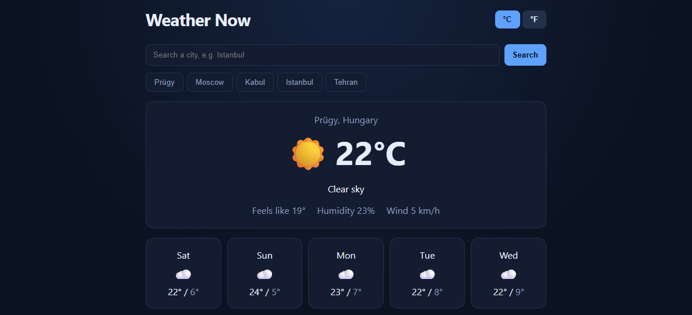

# Weather Now


A weather app built with **React 18** and **Vite**. It looks up any city and shows the current conditions plus a 5-day forecast, using the free [Open-Meteo](https://open-meteo.com) API (no API key required).

## Features

- City search through the Open-Meteo geocoding API
- Current temperature, feels-like, humidity and wind
- 5-day forecast
- °C / °F toggle
- Last 5 searches saved as quick buttons (localStorage)
- Loading and error states, and protection against outdated requests

## What this project demonstrates

- Fetching data with `fetch` and `async/await`
- `useEffect` with cleanup (a `cancelled` flag) to avoid race conditions
- Separating API code (`src/api.js`) from UI code
- Custom hook `useLocalStorage`
- Handling loading, empty and error states

## Run locally

```bash
npm install
npm run dev
```

Build for production: `npm run build`

## Ideas to extend

- Use the browser's geolocation for the user's current city
- Hourly forecast chart
- Tests with Vitest and React Testing Library
- Migrate to TypeScript

## Author

Zahra Haghjo · [LinkedIn](https://www.linkedin.com/in/zahrahaghjo) · [GitHub](https://github.com/zahrahaghjo)
